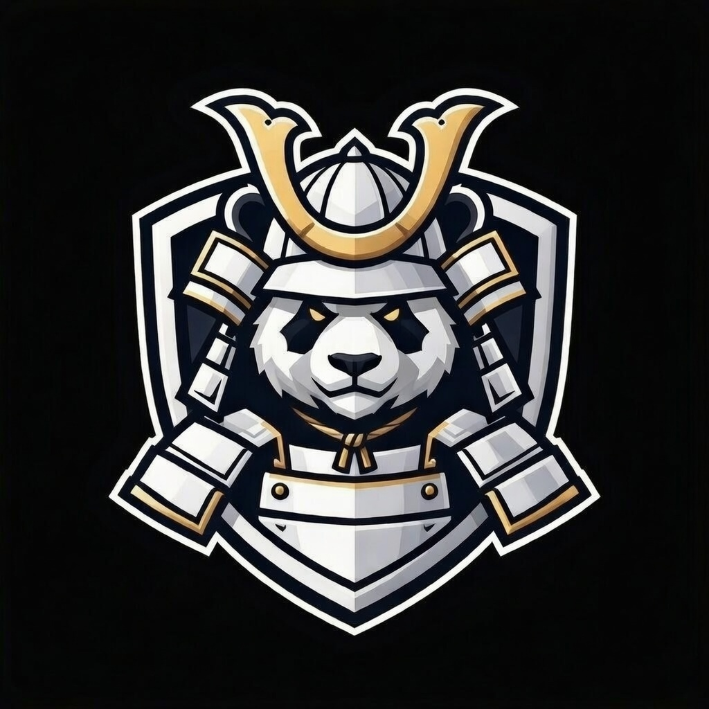

<p align="center">
  
</p>

<h1 align="center">🐼 The Panda Federation</h1>
<p align="center"><b>Self-healing, local-first AI systems and data tools that run themselves.</b></p>

<p align="center">
  
  
  
  
</p>

---

The Panda Federation is a family of small, dependable AI agents and data tools. Each module has one job, a name and a crest, and the job of keeping itself running. Agents watch other agents, failures get caught and repaired, and a human checks anything that matters before it ships.

**Spirit thinks. Watchdog watches. Steel acts.**

---

# 🧑‍💻 Creator Crest  
<p align="center">
  
  <br/>
  <sub>Sean — Founder of the Panda Federation</sub>
</p>

---

## 🚀 Live tools

| Tool | What it does | Try it |
|---|---|---|
| 📚 **Reference Checker** | Finds fake or AI-hallucinated citations, miscited details and retracted papers in any bibliography. Uses Crossref, Retraction Watch and OpenAlex. $0.01 per reference. | [apify.com/pandadad0214/reference-checker](https://apify.com/pandadad0214/reference-checker) |

---

## 🧭 Focus areas

- **Self-healing systems**: services that detect their own failures, restart, roll back and report.
- **Agents that monitor agents**: watchdogs, heartbeats and supervisors that keep other AI agents honest and online.
- **Data tools**: clean, verifiable data pipelines, from citation checks to tidy spreadsheets.
- **Local-first and private**: runs on your own hardware where it can, with you in control.

---

## 🌌 Core agents

### 🐼 Spirit Panda: the companion
Identity-driven, memory-aware and grounded.
<p>
  
</p>

### 🛡️ Watchdog Panda: the uptime guardian
Monitors processes and agents, and brings them back when they fall.
<p>
  
</p>

### ⚙️ Steel Panda: the executor
Runs tasks, maintains systems and carries out command workflows.

```
              ┌──────────────────────┐
              │    Watchdog Panda    │
              │  (uptime guardian)   │
              └──────────┬───────────┘
                         │ monitors
                         ▼
              ┌──────────────────────┐
              │     Spirit Panda     │
              │     (companion)      │
              └──────────┬───────────┘
                         │ triggers tasks
                         ▼
              ┌──────────────────────┐
              │     Steel Panda      │
              │      (executor)      │
              └──────────────────────┘
```

---

## 🔭 What's next

- More research-integrity and data tools on the Apify Store
- Citation formatting and verification services, human-checked
- Federation heartbeat: one dashboard where every Panda agent reports its health
- Open templates for self-healing agents and watchdogs

### 🐾 Family Agents (In Development)
- PandaMom  
- PandaLily  
- Teen Boy Panda  
- Teen Girl Panda  
- Child Pandas  

---

## 🧘 Philosophy

- **Sovereignty**: local-first, private, human-controlled.
- **Reliability**: tools that keep running and tell you when they can't.
- **Balance**: calm, grounded, intentional.

### 🐾 Family  
Technology should strengthen families.

---

<p align="center">
  
  <br/><br/>
  <i>“Build slow. Build steady. Build sovereign.”</i>
  <br/>
  <sub>The Panda Oath · Sean, founder of the Panda Federation</sub>
</p>

---

# 🌳 Federation Family Tree (Diagram)

```
PandaDad (Founder)
│
┌────────────────────┼────────────────────┐
│                    │                    │
PandaMom            Teen Boy Panda       Teen Girl Panda
│                    │                    │
├──────────────┬────┘          ┌─────────┘
│              │               │
Child Boy      Child Girl 1     Child Girl 2
│
Samurai Panda (Legacy Line)
```
